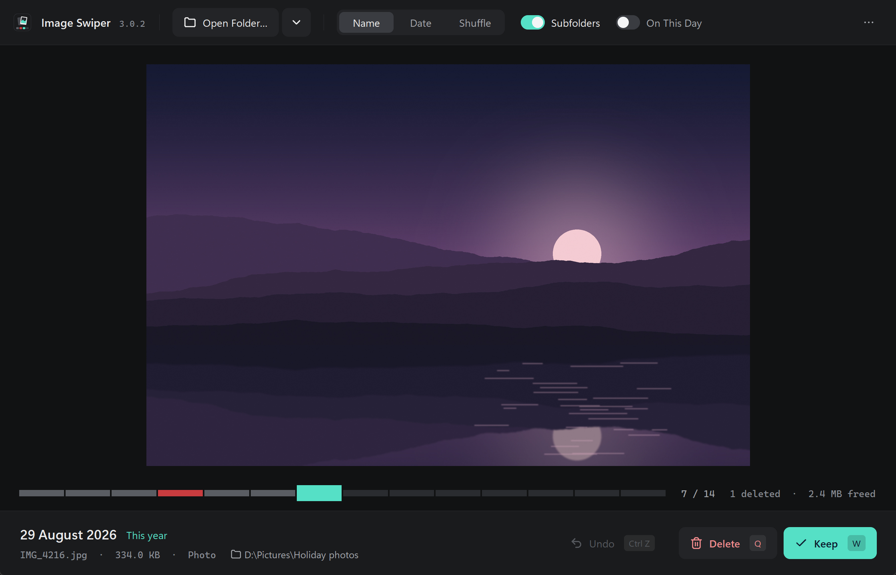
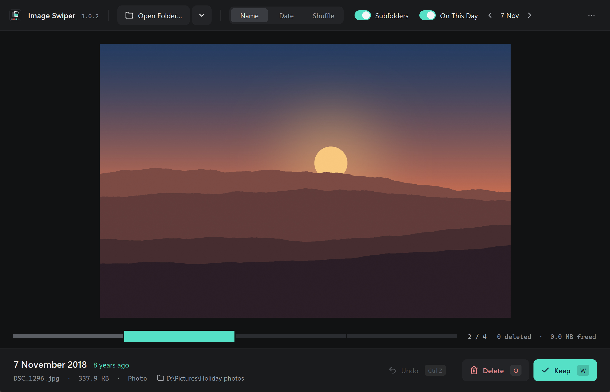

Go through a folder of photos and videos one at a time, keep what you want and
send the rest to the Recycle Bin. Turn on **On This Day** to see what you took on
today's date in every past year.

## Download

Get the latest version from
[Releases](https://github.com/TariqMK/Image-Swiper/releases). Under **Assets**,
download the file for your computer:

| Your computer | Download | Then open |
| --- | --- | --- |
| Windows (64-bit) | `windows-x64.zip` | `ImageSwiper/ImageSwiper.exe` |
| Mac with Apple silicon (M1 or later) | `macos-arm64.zip` | `ImageSwiper.app` |
| Linux (64-bit) | `linux-x64.tar.gz` | `ImageSwiper/ImageSwiper` |

Extract the download to a folder you can write to, such as Documents, and keep
everything inside it together. You don't need to install Python or anything else
to run it. Intel Macs aren't supported. On Linux you need a desktop environment;
Ubuntu 22.04 or newer is supported.

### First launch

Image Swiper isn't signed, so your computer may warn you the first time:

- **Windows:** if SmartScreen says it protected your PC, click **More info**, then
  **Run anyway**.
- **macOS:** if the app won't open, go to **System Settings › Privacy & Security**,
  scroll down and click **Open Anyway** next to Image Swiper.

### Optional: video previews

To see video thumbnails and use the date a video was recorded, install
[FFmpeg](https://ffmpeg.org/download.html) so that `ffmpeg` and `ffprobe` are on
your system `PATH`. On Windows, `winget install ffmpeg` does this. Without FFmpeg
you can still review videos and open them in your usual player.

## Reviewing a folder

1. Click **Open Folder…** (`Ctrl+O`, or `Cmd+O` on a Mac) and pick a folder. Leave
   **Subfolders** on to include every folder inside it.
2. Each photo or video appears in turn. Press **Keep** (`W`) to move on, or
   **Delete** (`Q`) to send it to the Recycle Bin.
3. Changed your mind? **Undo** (`Ctrl+Z` or Backspace) brings back the last file
   you deleted and shows it again. Undo is available on Windows.
4. When you reach the end you'll see how many files you reviewed and how much
   space you freed.

Under each photo you'll see the date it was taken, how many years ago that was,
its name, size and folder. Click the folder to open it in Explorer or Finder.

The strip under the photo shows the whole folder, one block per file: grey for
files you've passed, red for files you deleted, and teal for where you are now.
Click anywhere on the strip to jump there.

### Order

Use **Name**, **Date** or **Shuffle** in the toolbar to choose the order. Name
sorts numbers naturally, so `IMG_9` comes before `IMG_10`.

### On This Day

Turn on **On This Day** to see only photos and videos taken on today's date, in
any year, including this one. Use the arrows beside it to go back or forward a
day, for example to catch up on days you missed.

### Recent folders

Click the arrow beside **Open Folder…** to reopen one of your last three folders.
If a folder is on an external drive, connect the drive first.

## Keyboard shortcuts

| Key | Action |
| --- | --- |
| `W` | Keep and move to the next file |
| `Q` | Delete (send to the Recycle Bin or Trash) |
| `Ctrl+Z` or Backspace | Undo the last delete (Windows) |
| Right arrow | Next file |
| Left arrow | Previous file |
| `Ctrl+O` | Open a folder |

On a Mac, use `Cmd` instead of `Ctrl`. With the mouse, you can also click the left
or right edge of the photo to go back or forward, and click a video to play it in
your default player.

## Deleting safely

Image Swiper only deletes a file when you press **Delete** or `Q`. Keeping,
browsing, changing the order and On This Day never change your files, and kept
files stay exactly where they are.

- **Windows:** deleted files go to the Recycle Bin. Undo restores the most recent
  one; restore older ones from the Recycle Bin.
- **macOS and Linux:** deleted files go to the Trash. Restore them from the Trash;
  Undo isn't available on these systems.

There is no "are you sure?" prompt, so one press of `Q` sends a file to the bin.
Network drives and some USB drives don't have a Recycle Bin, so files deleted
there may be removed permanently. For your first session, try a copy of a folder
on your computer's own drive.

The space freed is the size of the files you've sent to the bin. You'll get that
space back once you empty the Recycle Bin or Trash.

## Supported files

- **Photos:** JPEG, PNG, GIF, BMP, WebP, TIFF, HEIC/HEIF and camera RAW files such
  as CR2, CR3, NEF, ARW, DNG and ORF. Large RAW files can take a moment to appear.
- **Videos:** MP4, MOV, AVI, MKV, WMV, WebM, M4V, 3GP, MTS and more. Videos play
  in your default player, not inside Image Swiper.

Dates come from the photo's or video's own capture information. If a file has
none, Image Swiper uses the date the file was last modified, which can put it on
the wrong day in On This Day.

## Updating

Download the new version and extract it. On Windows, copy the `cache` folder from
your old Image Swiper folder into the new one, beside `ImageSwiper.exe`. This keeps
your saved dates, video previews and recent folders. On macOS and Linux, your saved
data carries over automatically.

Upgrading on Windows from a version that stored data in AppData

Close Image Swiper, press **Win + R**, and open
`%LOCALAPPDATA%\ImageSwiper\data\`. Copy everything in it into the `cache` folder
beside the new `ImageSwiper.exe`, then open the app. If `cache` already has files
in it, back them up first. Nothing is moved automatically.

## Your data

Image Swiper runs entirely on your computer and doesn't connect to the internet.
To make repeat visits fast, it saves file dates, video previews and your last three
folders:

- **Windows:** in a `cache` folder beside `ImageSwiper.exe`
- **macOS and Linux:** in your account's application data folder

It never writes anything into your photo folders. To clear out previews of videos
you've since deleted, use **…** › **Clear Thumbnail Cache…** in the toolbar.

## Troubleshooting

- **The first scan is slow:** Image Swiper reads the date of every new file once.
  Next time the same folder opens much faster. You can close the app mid-scan.
- **Videos show "Preview unavailable":** install FFmpeg (see above). You can still
  click to play them.
- **A photo appears on the wrong day:** it probably has no capture date, so its
  file date was used instead.
- **Windows warns that the app is unsafe:** see [First launch](#first-launch).

Image Swiper starts from the beginning of the folder each time; it doesn't remember
where you stopped. Rotating photos, favourites and finding duplicates aren't
available yet.

## For contributors

See [development](docs/development.md) for running from source and tests,
[architecture](docs/architecture.md) for how the code is organised, and
[releases](docs/releases.md) for building a release.

## License

Free to use and modify. No warranty provided.
